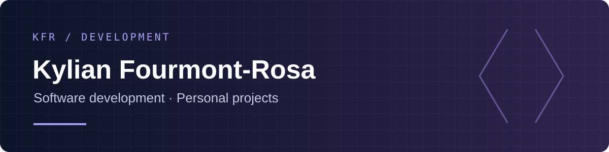

  

  

## 👨‍💻 About me

I'm a software development apprentice based in France, passionate about building applications and exploring new technologies.

- 🎓 Computer science student
- 💻 Software development apprentice
- 🚀 Building personal projects
- 🌱 Always learning new technologies

## Tech stack

### Languages

### Frameworks

### Development tools

## Projects

Discover my projects and professional journey:

- [Personal portfolio](https://kfr-portfolio.vercel.app/)
- [Public repositories](https://github.com/Kylianf-r?tab=repositories)

## GitHub activity

---

  <i>Always learning. Always building.</i>

